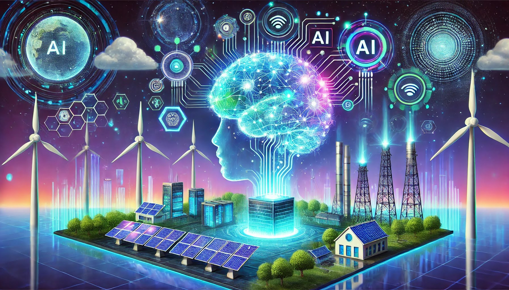

Menu
* [Main](https://makedon.ski/)
* [Research](https://makedon.ski/research)
* [Writings](https://makedon.ski/writings)
* [Work Highlights](https://makedon.ski/experience)
* [Contact](https://makedon.ski/contact)

---

# Research and Publications by Wyatt Makedonski
I try to advance the world by releasing knowledge completely open source in addition to my work. I enjoy research, learning, and sharing knowledge.

## “The Grid as a Computer”
*Makedonski, et al. (first author)*
* How do we build the grid of the future, one that is 100% carbon free and distributed (meaning that it can support many EVs, batteries, solar panels, and flexible appliances)? Right now, this is a critical open problem. I propose a system that aims to solve this problem and provides a solution that works in the near term and scales to the distant future. The system is fairly simple yet robust. I have been working on this system since 2021.
* On electricity grid architecture; proposed system enables an energy grid that is 100% renewable/carbon-free, heavily distributed (many DERs), and significant load growth from electrification of industries (electric vehicles, data centers, etc.). 
* Part 1 of 2.

## “Buildings are Computers”
*Makedonski, et al. (first author)*
* On electricity grid architecture; proposed system enables an energy grid that is 100% renewable/carbon-free, heavily distributed (many DERs), and significant load growth from electrification of industries (electric vehicles, data centers, etc.). 
* Part 2 of 2.

## “Dynamic Optimizing Virtual Power Plants: Advancing Distributed & Renewable Energy Resource Reliability and Adoption”
*Makedonski, et al. (first author)*
* Paper introduces more complex and realistic types of VPPs that are seen in the real world, including ones with dynamic DERs (such as EVs) and highly stochastic DERs (e.g. HVAC systems); proposes methods, algorithms, and ML models for the efficient, profitable, and reliable operation of this type of VPP.

## “Better Measuring Distributed Energy Loads to Increase Reliability and Accelerate Adoption”
*Makedonski, et al. (first author)*
* Paper introduces robust and comprehensive tools and methods for measuring distributed energy resources (DERs) and their aggregations (virtual power plants).

## “Intelligent Demand Response” [Working Title]
*Makedonski, et al. (first author)*
* Paper introduces concepts and methods for intelligent and adaptive Demand Response control to drastically improve real world operations and outcomes.
* Paper applies concepts from machine learning, reinforcement learning, and economics.

## “Transforming Power Loads: Measuring Difficulty in Changing Behaviors in Energy Usage” [Working Title]
*Makedonski, et al. (first author)*
* Paper answers the question, “How can we influence the behaviors of people using energy to improve outcomes?” in a rigorous and effective manner. Has broader implications in economics.

## “A Taxonomy of Virtual Power Plants and Their Dynamics”
*Makedonski, et al. (first author)*
* Paper discusses different types of VPPs, proposes a classification schema, discusses the various dynamics of each classification.

## “Nodal Optimizing Virtual Power Plants”
*Makedonski, et al. (first author)*
* Paper extends the DOVPPs paper and introduces a new type of VPP that is topologically-aware of grid infrastructure and can optimize its operations and constituent nodes for necessary real world operations.
* Paper applies concepts from mathematical optimization, graph theory, reinforcement learning, and economics.

# Economics
Some of my research has broader implications in economics and game theory which I am exploring.

## “Shapley Values Evolved” [Working Title]
*Makedonski, et al. (order TBD)*
* Extends the concept from game theory in economics and sometimes used in machine learning (ML)

